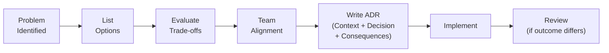

## Decision Log

We document significant architectural decisions as **Architecture Decision Records (ADRs)**. Each ADR captures the context, the options considered, the decision made, and the trade-offs accepted.

<CardGroup cols={2}>
  <Card title="ADR-001: Smithy as API IDL" icon="code" href="/decisions/adr-001-smithy" color="#f59e0b">
    Why we chose Smithy over OpenAPI-first or hand-written contracts as the single source of truth.
  </Card>
  <Card title="ADR-002: Rust + Actix-web" icon="gear" href="/decisions/adr-002-rust-stack" color="#16a34a">
    Why Rust over Go/Node for the backend, and why Actix-web + Diesel over Axum or SQLx.
  </Card>
  <Card title="ADR-003: JWT Auth Design" icon="lock" href="/decisions/adr-003-auth-design" color="#0891b2">
    Platform-service-account token issuance, stateless app JWTs (RS256), and Keycloak OIDC for admin/dashboard actors.
  </Card>
  <Card title="ADR-004: Provider-Keyed Consultation Messages" icon="comments" href="/decisions/adr-004-provider-keyed-consultation-messages" color="#7c3aed">
    Per-provider chat message contracts via a discriminated union. **Superseded by ADR-005** for the wire shape.
  </Card>
  <Card title="ADR-005: Neutral Consultation Message Shape" icon="comments" href="/decisions/adr-005-neutral-consultation-message-shape" color="#7c3aed">
    Replace the per-provider message union with one neutral wire shape we own; adapters map upstream messages into it.
  </Card>
  <Card title="ADR-006: Sponsor Order Anchor" icon="handshake" href="/decisions/adr-006-sponsor-order-anchor" color="#db2777">
    Make the sponsor match an explicit endpoint instead of a side effect of settling, and re-key its deterministic order id onto the self order it matches.
  </Card>
  <Card title="ADR-007: Config-Driven Action Engine" icon="sliders" href="/decisions/adr-007-config-driven-action-engine" color="#0d9488">
    Let configuration decide who an outbound action calls and what the answer means, so a new upstream is a config change rather than a code change.
  </Card>
  <Card title="ADR-008: Direct Kafka Publish for Domain Events" icon="tower-broadcast" href="/decisions/adr-008-event-producer-direct-publish" color="#dc2626">
    Publish domain events inline post-commit instead of via a transactional outbox — the outbox could not guarantee per-entity ordering.
  </Card>
  <Card title="ADR-009: Protobuf on the Event Bus" icon="file-code" href="/decisions/adr-009-protobuf-event-wire-format" color="#7c3aed">
    Encode events as protobuf with the payload packed as Any — non-Rust consumers are expected, and proto3's open enums make forward compatibility a property rather than a review discipline.
  </Card>
  <Card title="ADR-011: Config-Selected Benefit Create Side Effects" icon="list-check" href="/decisions/adr-011-config-selected-benefit-side-effects" color="#0d9488">
    Superposition decides per benefit which steps creating a benefit instance performs — MRN creation first — while each step stays typed Rust inside the owner's transaction.

  <Card title="ADR-010: Clinic Queue Gets Its Own Schema" icon="hospital-user" href="/decisions/adr-010-clinic-queue-own-schema" color="#14b8a6">
    Model the front desk as its own table in its own Postgres schema rather than a new benefit status, so an operational workflow cannot collide with the entitlement lifecycle that gates autopay.
  </Card>
</CardGroup>

---

## Decision Summary Table

| # | Decision | Status | Date |
|---|----------|--------|------|
| ADR-001 | Smithy IDL as API source of truth | Accepted | 2025-Q1 |
| ADR-002 | Rust + Actix-web + Diesel + PostgreSQL | Accepted | 2025-Q1 |
| ADR-003 | Bearer JWT auth (service-account issuance + Keycloak OIDC) | Accepted | 2025-Q1 |
| ADR-004 | Provider-Keyed Consultation Messages | Superseded by ADR-005 (wire) | 2026-Q2 |
| ADR-005 | Neutral Consultation Message Shape | Accepted | 2026-05 |
| ADR-006 | Sponsor order anchor + decomposing the sponsor leg | Accepted | 2026-07 |
| ADR-007 | Config-driven outbound action engine | Accepted | 2026-08 |
| ADR-008 | Direct Kafka publish for domain events (no outbox) | Accepted | 2026-08 |
| ADR-009 | Protobuf event wire format, payload packed as Any | Accepted | 2026-08 |
| ADR-011 | Config-selected benefit create side effects (MRN first) | Accepted | 2026-09 |

---

## How We Make Decisions

