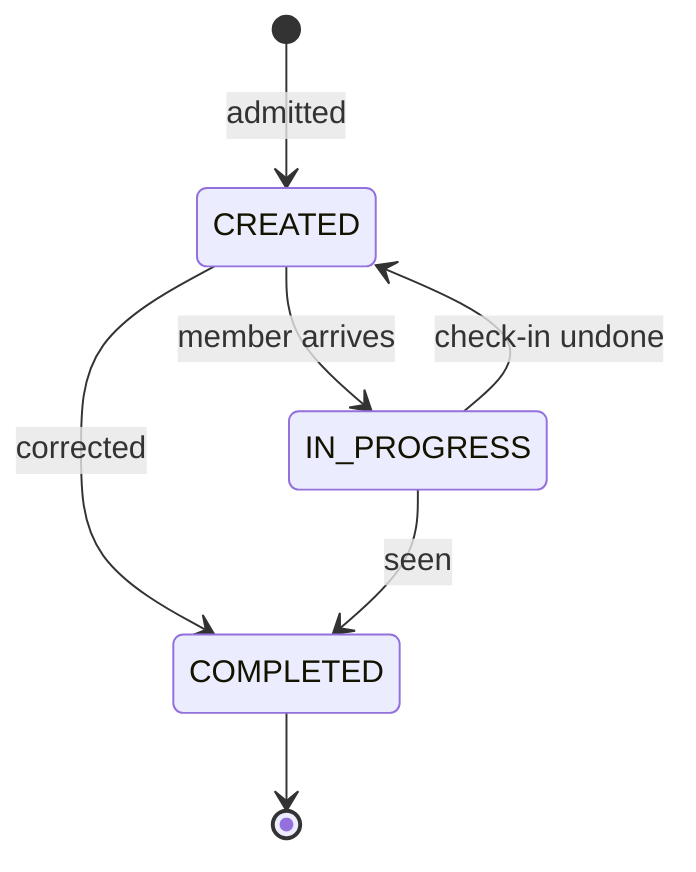

The **clinic queue** is the list a clinic's front desk works from: one row per
benefit instance a member is expected to attend for. It spans **every** benefit
type — an insurance policy's health check and a standalone health checkup queue
identically.

<Info>
  **The queue tracks the visit, not the entitlement.** A benefit instance's own
  status (`benefit_entities.status`) says whether a member is *entitled*; the
  queue says where they are in *today's* process. They are separate on purpose —
  see [Why not a benefit status](#why-not-a-benefit-status).

  **A consumer admits; an operator advances.** Rows are created automatically
  when a benefit instance is created, and moved through the workflow by clinic
  staff.
</Info>

## Row shape

| Field | Type | Notes |
|---|---|---|
| `benefit_entity_id` | string (uuid) | The queued benefit instance. Also the row's primary key |
| `entity_type` | enum | `INSURANCE_POLICY` \| `HEALTH_CHECKUP` |
| `user_id` | string(12) | The member |
| `user_name` | string | Resolved at read time — the queue stores no user columns |
| `phone_number` | string | Flattened, not nested |
| `phone_country_code` | string | Optional, defaults to `+91` |
| `mrn` | string | The member's MRN for this benefit's provider. **Omitted**, not null, when they have none yet |
| `benefit_id` | string (uuid) | The benefit being availed |
| `benefit_provider_id` | string (uuid) | The clinic's tenant |
| `status` | enum | `CREATED` \| `IN_PROGRESS` \| `COMPLETED` |
| `created_at` / `last_modified_at` | string (ISO 8601) | |

## The workflow



- **`CREATED`** — admitted; the member is expected but has not arrived.
- **`IN_PROGRESS`** — the member has reached the clinic and is being seen.
- **`COMPLETED`** — terminal.

`CREATED → COMPLETED` directly is allowed, so an operator correcting a row that
was never a real visit does not have to click through the check-in step.

<Note>
  The permitted edges are **configuration**, not code — served per
  `benefit_type` and `benefit_id`, so one clinic can narrow its own workflow
  without a release. A refused transition returns `400` with `CQE_1905`.
</Note>

## Admission

```bash
curl -X POST "$BASE_URL/clinic_queue/$BENEFIT_ENTITY_ID" \
  -H "Authorization: Bearer $TOKEN"
```

There is **no request body**. Every stored field is read from the benefit
instance named in the path, so a caller cannot place a row in another provider's
tenant by naming a different benefit.

<Warning>
  **Admission is idempotent, and re-admitting never rewinds.** The benefit
  instance's id *is* the row's primary key, so a repeated call returns the
  existing row **unchanged** with `200` rather than resetting it — a redelivered
  admission cannot undo a check-in the operator has already made. Only the first
  call returns `201`.

  The id is in the path rather than a body because the caller already knows the
  key: this is an action on a known instance, like `POST /mandates/{id}/sync`.

  One consequence: there is one queue entry per benefit instance **ever**.
</Warning>

## Listing

```bash
curl "$BASE_URL/clinic_queue?statuses=CREATED,IN_PROGRESS&entity_types=HEALTH_CHECKUP" \
  -H "Authorization: Bearer $TOKEN"
```

| Filter | Notes |
|---|---|
| `benefit_entity_id` | Point lookup — answers "is this instance queued?" without the `404` a direct read would give |
| `benefit_provider_id` | Admins may scope with it; a clinic's own callers are force-scoped and cannot widen |
| `name` | Case-insensitive prefix on the member's name |
| `phone_number` / `phone_country_code` | Exact match |
| `mrn` | Exact match on the MRN or temp number. **Admin-only** — silently ignored for other callers |
| `statuses`, `entity_types` | Comma-separated sets — `statuses=CREATED,IN_PROGRESS` matches either |
| `user_id` | Exact match |
| `start_time` / `end_time` | Bound `created_at` |
| `sort_on` / `sort_by` | `created_at` (default) or `last_modified_at`, `asc` / `desc` |
| `limit` / `offset` | Clamped server-side |

Responses use the standard `{ data, total, limit, offset }` envelope.

<Warning>
  A caller scoped to one clinic sees only that clinic's rows, whatever
  `benefit_provider_id` it sends. On a single read, another tenant's row returns
  **`404`, not `403`** — a `403` would confirm the id exists.
</Warning>

## Advancing a row

```bash
curl -X PATCH "$BASE_URL/clinic_queue/$BENEFIT_ENTITY_ID/status" \
  -H "Authorization: Bearer $TOKEN" \
  -H 'Content-Type: application/json' \
  -d '{"status": "IN_PROGRESS"}'
```

Setting the status a row already holds is a **no-op**, not an error — a retrying
caller gets `200` and the unchanged row.

## Why not a benefit status

The obvious-looking alternative is a new value on `benefit_entities.status`.
It was considered and rejected for three reasons.

<AccordionGroup>
  <Accordion title="One entitlement can produce several visits">
    A member who no-shows and returns next week is a second visit against the
    same entitlement. Encoded as a status, the first visit is overwritten, and
    "no-showed, then returned" cannot be represented at all.
  </Accordion>
  <Accordion title="The two states the queue distinguishes collapse to one">
    An insurance policy that is `Pending` and one that is under `Verification`
    both project onto the same benefit status. The ledger literally cannot tell
    "waiting" from "at the clinic" — the distinction the queue exists to make.
  </Accordion>
  <Accordion title="A front-desk click would sit on a column that moves money">
    A benefit instance going `ACTIVE` is one of the two preconditions for
    autopay. Putting the queue's workflow on that column would let a
    receptionist's action start a payment flow.
  </Accordion>
</AccordionGroup>

## Errors

| Code | HTTP | When |
|---|---|---|
| `CQE_1900` | 500 | Unexpected failure |
| `CQE_1901` | 404 | No queue entry with that id, or it belongs to another tenant |
| `CQE_1902` | 400 | Malformed request |
| `CQE_1903` | 404 | Admission named a benefit instance that does not exist |
| `CQE_1904` | 403 | Not an operator for this tenant |
| `CQE_1905` | 400 | The workflow does not permit that transition |
