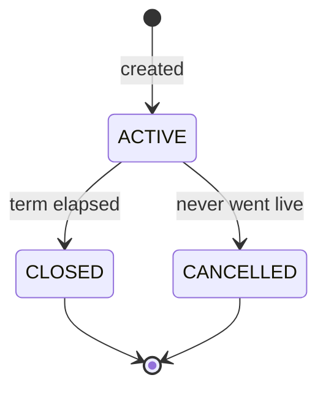

<Info>
  **Auth:** the reads and `register_mandate` require a valid bearer token and
  nothing more — there is no per-caller authorization yet, so any authenticated
  caller sees any user's goals. The consumer-rung and Kronos-fired routes require
  the callback-service actor. See [Auth](#auth) below.
</Info>

<Warning>
  **There is no create endpoint.** Goals are written by whichever flow owns them
  (insurance-policy issuance is the first), which also opens the goal's HSA pool.
  A public create endpoint arrives in a later release.
</Warning>

## Endpoints

| Route | Who calls it | What it does |
|---|---|---|
| `GET /goals/{goal_id}`, `GET /goals` | any authenticated caller | read a goal / list goals |
| `GET /goals/contributable` | contributor token | the beneficiary's goals that can take money right now on the token's tip rail — see [contributor tokens](#contributor-tokens) |
| `POST /goals/{goal_id}/mandate/register` | app user | register the goal's autopay mandate + open the Juspay session |
| `GET /goals/{goal_id}/mandate/active` | any authenticated caller | the goal's live mandate, if any |
| `POST /goals/{goal_id}/mandate/set`, `.../unlink` | callback service | link / unlink `goals.mandate_id` |
| `POST /goals/{goal_id}/contribution/self/manual` | app user | a one-off top-up: order + Juspay session |
| `POST /goals/{goal_id}/contribution/self/auto` | Kronos | the daily autopay debit — see [autopay](#autopay) |
| `POST /goals/{goal_id}/contribution/sponsor` | callback service | match a settled self contribution with the sponsor's share — see [sponsor matching](#sponsor-matching) |
| `POST /goals/{goal_id}/contribution/tip/indirect` | `INDIRECT` contributor token | record a tip given on a platform's own surface — see [indirect tips](#indirect-tips) |
| `POST /goals/{goal_id}/contribution/tip/direct` | `DIRECT` contributor token | tip by paying our payment page — see [direct tips](#direct-tips) |
| `POST /goals/{goal_id}/contribute` | callback service | credit the goal for a settled order |
| `POST /goals/{goal_id}/spend` | callback service | draw the goal down by a settled purchase |

---

## Autopay

Once a goal has a linked, `LIVE` mandate, Kronos fires
`POST /goals/{goal_id}/contribution/self/auto` on a daily cron. Each firing:

1. resolves the goal's mandate through **`goals.mandate_id`** — the explicit
   link, so a mandate the goal was never linked to is never charged;
2. computes the user's share of the daily premium (a sponsor covering the whole
   premium leaves nothing to charge, and the firing stops with a 400 rather than
   sending Juspay a doomed zero-amount debit);
3. mints the funding order on the goal's own HSA pool, with `goal_id` set and
   `channel = mandate`;
4. hands that order to the shared execution core — PBA hold, Juspay `/txns`
   charge, status write. See the
   [Mandate Execution Module](./mandate_execution) for the core's mechanics and
   its three idempotency layers.

The per-firing `X-Idempotency-Key` header is required: it is both the
execution claim key and the seed for the order id, so replaying a firing means
reusing the exact same value.

The money is **held, not credited**, at this point. The goal's balance moves only
when the settled order rings `POST /goals/{goal_id}/contribute` — and the sponsor's
matching share is its own step, not part of the settle. See
[sponsor matching](#sponsor-matching).

## Sponsor matching

Every contribution leg follows the same lifecycle — **create, settle, credit**. Nothing
moves a goal's money as a side effect of settling something else.

The sponsor's share is therefore its own step:
`POST /goals/{goal_id}/contribution/sponsor`, whose body carries the **settled self
order** being matched:

```json
{ "order_id": "0198f2c1-...-a41d" }
```

It mints a sponsor order on the goal's own pool, transfers the sponsor's share into it,
and returns **that whole order** — pass its `id` to `POST /goals/{goal_id}/contribute` to
move the goal's `others_accumulated` counter, and read `amount` off it to see what was
matched, with no second lookup.

```json
{
  "outcome": "SETTLED",
  "order": {
    "id": "0198f2c1-...-77b0",
    "amount": { "value": 38.0, "currency": "INR" },
    "source": "sponsor:0198c4d1-...-9e02",
    "medium": "SPONSOR",
    "status": "SUCCESS",
    "goal_id": "0198e0aa-...-3b12",
    "goal_credited": false
  }
}
```

**`SKIPPED` is a normal answer, not a failure.** A plan may configure no sponsor share at
all, or no sponsor to draw from. The response is still 200 with
`outcome: "SKIPPED"`, `order: null` and a human-readable `detail` saying which — because
the user's own money has already moved and must never be reversed over missing sponsor
configuration. Branch on `outcome`, not on the status code.

**Safe to ring repeatedly.** The sponsor order id is derived from the self order id, so a
retry resolves the same row and re-uses the same payment-provider idempotency key. It can
neither create a second sponsor order nor transfer twice.

The order it wants is the **self** order — the one the user's money went through. Passing a
sponsor order back in is rejected with a **409** whose `message` names the order. (Match on
the status and the `message`, never on the `code` — see the note above the error table.)

## Contributor tokens

A partner backend mints a short-lived contributor token with `POST /auth/contributor_token`
and hands it to the client collecting the tip. Two things about the token decide what it
can do.

**`tip_type` picks the rail.** `INDIRECT` (the default when omitted) or `DIRECT`. A token
works only on its own rail's tip route — the other answers **403** — and only a `DIRECT`
token may poll `POST /orders/{order_id}/sync`.

**The beneficiary is the token's, or `x-user-id`.** A token minted with a phone is bound to
that user, and an `x-user-id` header on its requests is ignored. A token minted without one
names the beneficiary on each request in `x-user-id`; with neither, the request is a
**400**. On the goal routes the beneficiary must be an active user — an unknown or inactive one is the same 400.

`GET /goals/contributable` answers per rail:

| | `INDIRECT` token | `DIRECT` token |
|---|---|---|
| Goals listed | `ACTIVE`, with a live linked mandate | every `ACTIVE` goal |
| `max_contribution_amount` | the mandate's per-debit ceiling | `null` — no mandate, no ceiling |
| `contribution_presets` | from configuration, capped at the ceiling | `null` |

## Indirect tips

A passenger tips a driver inside a platform's own app. The money lands in the driver's
platform earnings, not with us — so the tip is *recovered* onto the driver's goal using
their existing autopay mandate as the rail.

<Steps>
  <Step title="Intent">
    The platform's backend rings `POST /goals/{goal_id}/contribution/tip/indirect` with
    a contributor token, naming its own reference for the thing tipped on
    (`external_reference_id`) plus the declared `amount` and `currency`.

    An order is minted `EXPRESSED` — declared, but nothing is collectable until the
    upstream finishes. The goal must already have a **live mandate**: without one the tip
    could never be recovered, and failing here beats failing hours later.

    The amount may not exceed the goal's mandate ceiling. Read the ceiling from
    `max_contribution_amount` on `GET /goals/contributable` and validate before
    submitting — it is the mandate's registered per-debit limit, so an amount above it
    would be refused by the payment provider even if we let it through.

    <Warning>
      Over the ceiling currently answers **404 `AE_4`**, not a 400/422 — every `GoalError`
      collapses through `AarokyaAppError`, and this variant lands on `ResourceNotFound`.
      Branch on the message, not the status.
    </Warning>
  </Step>
  <Step title="Poll">
    A scheduled job rings `POST /orders/{order_id}/sync`, which asks the platform whether
    the tip was actually collected. Three answers:

    - **collected** → the order takes the *collected* amount and moves to `INITIATED`
    - **not collected** → `DECLINED`, terminal
    - **undecidable** (not finished, upstream unreachable) → nothing is written and the
      next firing asks again
  </Step>
  <Step title="Recover">
    From `INITIATED` the order is charged on the mandate rail exactly like an autopay
    debit. A debit that fails lands on `RECOVERY_FAILED` rather than `FAILED` — the tip
    exists in the driver's platform earnings and we could not retrieve it, which is a
    different problem from a debit that moved no money at all.
  </Step>
</Steps>

## Direct tips

The contributor pays **us**, not the platform. They scan a QR, land on a web page and
settle on our payment page — so there is nothing to recover and no mandate involved.

<Steps>
  <Step title="Intent">
    `POST /goals/{goal_id}/contribution/tip/direct` with a contributor token and the
    `amount` + `currency`. An order is minted `INITIATED` on the payment rail and a Juspay
    session is opened; the response carries its payload for the page to render.

    No mandate is required — that is the whole difference from the indirect rail. The goal
    must be active, and the beneficiary (the token's, or `x-user-id`) must own it.
  </Step>
  <Step title="Settle">
    The ordinary settlement poll rings `POST /orders/{order_id}/sync` until Juspay reports
    a terminal status — the same path a manual self contribution takes. There is no
    platform to ask: the money came through our own page, so Juspay is the only authority
    on whether it landed.
  </Step>
  <Step title="Credit">
    `POST /goals/{goal_id}/contribute` confirms the deposit and credits the goal's
    third-party bucket, exactly as an indirect tip does. The deposit quotes the
    **platform's** bank as its origin, which is what books it away from the driver's own
    contributions.
  </Step>
</Steps>

<Note>
  There is no idempotency anchor. A repeat call mints a second order and a second payment
  session — the contributor pays one and the other is abandoned. This matches the manual
  self-contribution rail; an anchor would need an id the platform does not mint.
</Note>

<Info>
  **Who paid is recorded, but not queryable.** `contributor_ref` and
  `contribution_channel` are written into the order's metadata from the token when it
  carries them. The order's `user_id` is always the **beneficiary** — the driver whose
  goal is funded — so the contributor appears nowhere else.
</Info>

<Note>
  **The declared amount is not authoritative.** Whatever the passenger declared, the
  collected figure wins — collected money is the money that exists. A zero declared
  amount is legal: an intent may be recorded before any amount is known.
</Note>

<Warning>
  Idempotent on the platform **and** its reference together. A reference is unique per
  platform, not globally, so two platforms using the same one must not resolve the same
  order.
</Warning>

---

## Overview

A **goal** is a user's savings target with an evaluation cadence. It points at the user's HSA pool (an `accounts` row with `account_type = HSA`) and tracks how much has been accumulated — self plus sponsor — toward a target amount over a start-to-end span, evaluated every period.

Nothing here **creates** a goal — that belongs to whichever flow owns it. What this module does own is everything that happens to a goal afterwards: reading it, linking its autopay mandate, and the money rails that fund it (manual top-up, autopay) and draw it down (spend).

- **Purpose is stored as a URN, returned split**: the `purpose` column encodes intent as a single string — `category:healthcare`, `category:education`, or `specific:BENEFIT_ENTITY_ID`. Only `healthcare` and `education` categories exist for now. Responses do **not** carry that string: `purpose` comes back as a `kind`-tagged object (`{"kind": "CATEGORY", "category": "healthcare"}` or `{"kind": "SPECIFIC", "benefit_entity_id": "..."}`), so no client parses the URN. `GET /goals/contributable` adds a second field, `purpose_details` — the same split plus `benefit_type` resolved from the funded entity. It is a sibling rather than a richer `purpose` because that read flattens `GoalResponse`, and two `purpose` keys cannot coexist on one object; every other goal read skips the entity lookup and so ships `purpose` alone.
- **Lifecycle-only status**: `ACTIVE`, `CLOSED`, `CANCELLED` — terminal-vs-live only. Whether a goal is *running right now* is answered by its **term**, not its status: a goal is `ACTIVE` from creation even when its term starts in the future.
- **Optional term**: `start_date`/`end_date` may be null (plain `YYYY-MM-DD` dates). A goal created alongside an insurance policy has no term until the carrier issues that policy and supplies the dates.
- **Many goals per user**: one per funded entity. A partial unique index on `purpose` enforces one goal per `specific:` entity; combined with the policy's own one-live-policy-per-(user, benefit) rule, that inherits one-goal-per-(user, benefit) with no app-level check.
- **HSA pool, not a column**: the goal references its HSA `accounts` row by id, and each goal owns its own pool. Opening that pool belongs to whichever flow creates the goal, not to this module.

---

## Lifecycle



`ACTIVE` does not mean "currently accruing" — a goal whose term starts next month is still `ACTIVE`. Anything that accrues or evaluates against a goal gates on `now >= start_date`, exactly as an insurance policy is `Issued` before its coverage begins.

`target_amount` is the cumulative total over the whole span, not a per-period figure. `target_met` is **computed, never stored** — it is true when `self_accumulated + sponsor_accumulated + others_accumulated >= target_amount`. Tips count toward the target: money in the pool is money toward the goal, whoever put it there. Because accumulated amounts only grow, it is monotonic and needs no state transition.

---

## Contribution ratio

`contribution_ratio` is the self/sponsor split. Each leg —
`self_contribution` and `sponsor_contribution` — is a structured amount
(`value` plus `currency`), the same shape used for every other money field on the
goal response, and always present.

Internally the amounts are stored as exact minor units denominated in the goal's
own `currency`; the API converts to the structured amount at the boundary.
`target_amount` and the five projection amounts (`self_accumulated`,
`sponsor_accumulated`, `others_accumulated`, `self_spent`, `sponsor_spent`) carry
that same shape.

<Note>
Money in has **three** legs; money out has **two**. `self_accumulated` is the goal
owner's own money, `sponsor_accumulated` an employer or scheme subsidy, and
`others_accumulated` tips collected on a platform's behalf — a passenger's tip and
an employer's subsidy are different money, so they no longer share a leg.

There is deliberately no `others_spent`. A purchase is settled by PBA, which
reports the split as `from_self` / `from_others` only, so a third spend leg has
nothing to populate it. Reconciliation therefore pairs the two third-party inflow
legs against the single outflow leg:
`(sponsor_accumulated + others_accumulated) − sponsor_spent`.
</Note>

---

## Term

`start_date` and `end_date` are **optional, and stored all-or-nothing** — a goal
carries either both or neither. A goal created alongside an insurance policy has
no term until the carrier issues that policy; it is `ACTIVE` throughout, with a
null term, and gets its dates stamped at issuance.

That rule is a modelling invariant, not something this module enforces: there is
no write path here to validate it, and no database CHECK backs it. Enforcement
belongs to whichever flow writes the goal.

---

## Auth

<Warning>
  **The bearer-auth endpoints are authenticated but not authorized.** A valid token is
  required, but no further check is made: any authenticated caller can read any
  user's goal, register a mandate on any user's goal, and `GET /goals` without a
  `user_id` filter returns **every goal in the system**. Authorization is
  deliberately deferred to a later release. Treat those routes as internal-only
  until then.
</Warning>

| Route | Who may call | What they see |
|---|---|---|
| `GET /goals/{goal_id}` | any authenticated caller | any goal, regardless of owner |
| `GET /goals` | any authenticated caller | all goals; `user_id` is an optional plain filter, not a scope |
| `POST .../mandate/register`, `GET .../mandate/active`, `POST .../contribution/self/manual` | any authenticated caller | any goal, regardless of owner |
| `POST .../mandate/set`, `.../mandate/unlink`, `.../contribution/self/auto`, `.../contribution/sponsor`, `.../contribute`, `.../spend` | callback service only | — |

None of the bearer-auth routes carries a `user_id` path label, so ownership could
only be settled after the goal is fetched — that check is what the later release
adds. Until it lands, a missing token is their only rejection: **401**, never
**403**. The callback-service routes do reject a wrong actor with **403**.

---

## Error codes

<Warning>
  `GLE_18xx` numbers are **internal identifiers, not wire values.** Routes return
  the app-level error type, so the `code` field of an error response is always the
  generic `AE_0N` class code — never `GLE_1801`. The goal-specific detail reaches
  you through the HTTP status and the `message`. Match on those; never on `code`.
</Warning>

The band is reserved for the goal domain as a whole, so a few numbers below are
raised only by the internal flow that creates goals, never by a route here.

| Code | HTTP | Meaning | Raised by |
|---|---|---|---|
| `GLE_1800` | 500 | Internal error | every route |
| `GLE_1801` | 404 | Goal not found | every route |
| `GLE_1802` | 400 | Validation error | goal not active, non-positive contribution, zero autopay debit, dead mandate |
| `GLE_1803` | 409 | User has no active savings account | goal-creating flow only |
| `GLE_1804` | 500 | Amount conversion failed | any route returning a goal |
| `GLE_1805` | 500 | Failed to provision the PBA account for the goal | goal-creating flow only |
| `GLE_1806` | 403 | App users may only list their own goals | nothing yet — reserved until authorization lands |
| `GLE_1807` | 409 | A goal already exists for this benefit | goal-creating flow only |
| `GLE_1808` | 409 | Goal is already linked to a different mandate | `mandate/set` |
| `GLE_1809` | 500 | Mandate registration failed | `mandate/register` |
| `GLE_1810` | 409 | Mandate is not bound to this goal's pool | `mandate/set` |
| `GLE_1811` | 404 | Mandate not found | `mandate/set`, `contribution/self/auto` |
| `GLE_1812` | 409 | Mandate is terminal and cannot be linked | `mandate/set` |
| `GLE_1813` | 404 | Goal has no live / linked mandate | `mandate/active`, `contribution/self/auto` |
| `GLE_1814` | 500 | Payment provider unavailable | `contribution/self/manual`, `contribution/self/auto`, `contribution/sponsor` (the PBA transfer — retryable) |
| `GLE_1815` | 404 | Order not found | `contribute`, `contribution/sponsor` |
| `GLE_1816` | 409 | Order does not belong to this goal | `contribute`, `contribution/sponsor` |
| `GLE_1817` | 409 | Order is not settled | `contribute`, `contribution/sponsor` |
| `GLE_1818` | 409 | Order currency differs from the goal's | `contribute`, `contribution/sponsor` |
| `GLE_1819` | 404 | Benefit-provider order not found | `spend` |
| `GLE_1820` | 409 | Purchase does not belong to this goal | `spend` |
| `GLE_1821` | 409 | Purchase is not settled | `spend` |
| `GLE_1822` | 409 | Purchase carries no self/sponsor split | `spend` |
| `GLE_1823` | 409 | Order is not a self contribution | `contribution/sponsor` |
