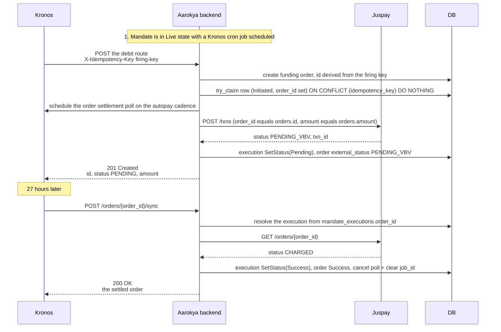

<Note>
  **Auth guard:** the Kronos-fired routes — the goal-scoped mint, `execute` and
  the order-scoped reconciliation — require the callback-service actor
  (`actor.require_callback_service()`). `GET /mandate_executions` is admin /
  readonly-admin only; the single-execution read uses
  `require_self_or_trusted_backend`.
</Note>

## Overview

Mandate execution is the runtime side of the mandate lifecycle —
where a registered mandate (from the [Mandate Module](./mandate)) is
**actually charged**. The mandate must be in the `LIVE` state. Kronos-fired
routes drive it:

1. **The mint — `POST /goals/{goal_id}/contribution/self/auto`.** Kronos fires
   this once per autopay cycle, against the **goal**, not the mandate. It mints
   the funding order on the goal's own HSA pool (with `goal_id` set) and stops
   there, answering with the order. Documented in the [Goal Module](./goal).
2. **The charge — `POST /mandates/{mandate_id}/execute`.** Reached from the
   `goal.contribution_order.initiated` event, not from Kronos. The funding order
   is named by `order_id` in the request body; the route claims a
   `mandate_executions` row (idempotent on the `X-Idempotency-Key` header),
   parks the PBA hold, calls Juspay's `/txns` to debit, and stamps the txn status.
   Splitting mint from charge means a charge that needs re-driving replays only
   the charge.

   The order is **checked against the mandate** before anything moves, on both its
   funding source and its settlement rail. Only mandate-rail orders are chargeable
   at all: an autopay debit has its id re-derived from the firing key and compared,
   and an indirect tip — whose id is minted against a ride, not a firing — must
   belong to a goal linked to this mandate. Everything else is refused, since it
   never reaches a mandate: a manual top-up and a direct tip are collected at a
   payment page, and a sponsor leg moves over PBA.
3. **The reconciliation — `POST /orders/{order_id}/sync`.** There is no separate
   status-check route: an autopay debit reconciles on the same settlement seam
   every other order uses. `sync_order`'s `mandate`-medium arm resolves the
   execution from the order (`mandate_executions.order_id` is `NOT NULL`), polls
   Juspay, and settles both rows together.

   The order half is **status only** for a goal-linked debit: it advances
   `OrderStatus` and writes the execution status, and that is all. The PBA hold parked
   in step 1 is confirmed by `POST /goals/{goal_id}/contribute`, and the sponsor's share
   is matched by `POST /goals/{goal_id}/contribution/sponsor` — both rung by the consumer
   reacting to the settle, not by the settle itself. (A **failed** debit is the exception:
   its hold is released inside the settle, since `/contribute` only ever runs on a settled
   order.) See [ADR-006](/decisions/adr-006-sponsor-order-anchor).

   It runs on its **own cadence**, though — the shared `order.settlement_poll.*` knobs
   resolved under `medium = "mandate"`, not the `medium = "payment"` override a manual
   contribution gets. Same route, same knob names, two sets of values and two
   kill-switches. If still non-terminal when the Kronos window (`ends_at`) expires, the
   row sits in its last non-terminal status for operator inspection — no forced terminal
   state. On a terminal settle the poll job is cancelled and `orders.job_id` cleared.

The debit is **order-first**: the funding order is created before the execution
claim, and its id is derived from the firing key rather than generated fresh.
That is what makes a retry resolve the existing order instead of minting a second
one — see [idempotency](#three-layer-idempotency) below.

There is **no per-firing state in the request body**. Each firing is
identified by the `X-Idempotency-Key` header (templated by Kronos via
`{{execution.execution_id}}`), and the attempt cadence is implicit in Kronos's
cron schedule — no DB column tracks attempts.

Two **read routes** (not Kronos) surface those rows. `GET /mandate_executions` is
the paginated admin list — filter by `execution_id`, `mandate_id`, `order_id`, `statuses` or a
`created_at` window — with each row joined to its order's Juspay
`external_order_status`. There is deliberately **no per-user filter**: `mandate_id`
is the dimension that matters, and `mandate_executions` carries no `user_id` column
of its own (the user lives on the parent mandate), so scoping by user would mean a
join for a lookup nobody needs.

The single-execution read is keyed on `mandate_id` + `execution_id` — no `{user_id}` —
and fails closed: the caller must own the mandate (asserted against the row, not the
path) and the execution must belong to that mandate, so a guessed id returns 404 rather
than another user's row.

---

## Endpoints

<CardGroup cols={2}>
  <Card title="POST /goals/{goal_id}/contribution/self/auto" icon="bolt" color="#dc2626" href="/api/endpoints/goals/auto-contribution">
    Mint the funding order for the goal's autopay cycle. Returns the order; charging it is `execute`'s job. Callback-service auth.
  </Card>
  <Card title="POST /mandates/{mandate_id}/execute" icon="bolt-lightning" color="#dc2626" href="/api/endpoints/mandate-execution/execute">
    Claim the firing and charge the already-minted order. Returns 201 on first claim, 200 on idempotent replay. Callback-service auth.
  </Card>
  <Card title="POST /orders/{order_id}/sync" icon="rotate" color="#dc2626" href="/api/endpoints/orders/sync">
    Reconcile the debit — the `mandate`-medium arm settles the order and its execution together. Self-or-callback auth.
  </Card>
  <Card title="GET /mandate_executions" icon="list" color="#7c3aed" href="/api/endpoints/mandate-execution/list">
    Paginated execution list, each row joined to its order's Juspay `external_order_status`. Filter by `execution_id` / `mandate_id` / `order_id` / `statuses`. Admin auth.
  </Card>
  <Card title="GET /mandates/{mandate_id}/executions/{execution_id}" icon="magnifying-glass" color="#2563eb" href="/api/endpoints/mandate-execution/get">
    Single execution by id, carrying the linked `order_id`. Fails closed on cross-ownership. Bearer auth.
  </Card>
</CardGroup>

---

## Lifecycle

If Juspay reports a still-non-terminal status on a reconciliation
firing, the next Kronos firing (15min later) re-checks, up to
`order.settlement_poll.max_attempts` firings bounded by the cron window.

---

## Three-layer idempotency

Kronos retries on transient failures, so duplicate firings are
expected. Every layer is anchored on the same value — the
`X-Idempotency-Key` header — so they cannot disagree about which firing
they belong to:

1. **Order primary key** — the autopay funding order's id is derived from the firing
   key (a UUIDv5 over it), not generated fresh. A retry derives the **same** id, hits
   the primary key, and resolves the existing row instead of minting a second
   order. The resolved row's owner is asserted before it is charged, so a
   recycled firing key cannot charge somebody else's order.
2. **DB claim** — `INSERT ... ON CONFLICT (idempotency_key) DO NOTHING
   RETURNING *`. Exactly one concurrent caller wins; the loser reads
   the winner's row and returns it. The conflict key is `idempotency_key`
   (the same header value). Because the order is created first, the claim
   carries its `order_id` from birth — there is no window where a claimed
   firing has no order for the reconciliation cron to follow.
3. **Juspay-side dedup** — Juspay deduplicates on `order_id`. We pass
   `order_id =` the linked orders-ledger row id (`orders.id`), stable across
   retries, so a firing-retry that somehow slips past the DB claim still
   doesn't double-charge.

The charge amount comes off the **order**, never a freshly recomputed figure: an
order that pre-exists from an earlier attempt is the single source of truth, so a
change to `insurance.user_contribution` between retries can't make the charge, the
order row, and the execution row disagree.

The reconciliation arm adds a further guard: a **terminal-state fast-path**. If the
execution's status is already terminal (`Success | Failed`), it returns the order
as-is without hitting Juspay.

---

## Status vocabulary

The execution row's `status` is the **internal firing lifecycle**
(`common_enums::MandateExecutionStatus`) — repo-owned vocabulary, **not**
the Juspay status. The Juspay-side status lives on the linked funding order
(`orders.external_status`, reached via `mandate_executions.order_id`), so the
execution row never stores provider strings.

| Status | Meaning | Terminal? |
|---|---|---|
| `INITIATED` | Firing claimed; charge not yet confirmed (re-drivable on retry) | No |
| `PENDING` | Charge dispatched to Juspay; reconciliation cron owns settling it | No |
| `SUCCESS` | Debit settled (`/orders` returned `Charged`) | **Yes** |
| `FAILED` | Debit declined, or the order never reached Juspay (`/orders` 404) | **Yes** |

The mapping from the provider's `ExternalOrderStatus` to this enum is
`From<&ExternalOrderStatus>`: `Charged → Success`; `Failed` and the various
failure states (`AuthenticationFailed`, `AuthorizationFailed`, `JuspayDeclined`,
`AutoRefunded`) → `Failed`; and any non-terminal Juspay state (`PendingVbv`,
`Authorized`, `Authorizing`, `Other(_)`, …) → `Pending`. The wire value is
SCREAMING_SNAKE_CASE (`INITIATED` / `PENDING` / `SUCCESS` / `FAILED`).

---

## Debit amount

The amount Aarokya charges per firing is the Superposition key
`insurance.user_contribution` (paise), resolved on the user's single `Issued` insurance
policy — its plan, benefit and the platform it was created under. There is no premium
maths: each plan (and each platform that differs) carries its own figure, and the
sponsor match is configured separately (`insurance.sponsor_contribution`).

Default `0`: a plan with no configured user contribution, or a user with zero /
multiple `Issued` policies, fails the firing — there's no policy linkage on the
mandate row today. Key the value on `plan_code` / `platform_slug` only, never a status
dimension: the goal stamps it at creation, the debit reads it once the policy is issued.

Because the debit runs on the goal rail, those failures reach the caller as the
**goal** module's codes, not the `MXE_16xx` ones below; see
[Goal Module → Error codes](./goal#error-codes).

---

## Error responses

`execute`, the reconciliation route and the read routes raise these. The rows
marked *retired* moved to the goal rail when order creation did; their numbers
stay reserved and are never reused.

| Code | Status | Error | Situation |
|---|---|---|---|
| `MXE_1600` | 500 | Internal error | Unexpected failure |
| `MXE_1601` | 400 | Validation error | Bad input (e.g. mandate_id/execution_id mismatch) |
| `MXE_1602` | 500 | Provider unavailable | Juspay returned 5xx or timed out |
| `MXE_1603` | 404 | Mandate not found | `mandate_id` doesn't exist |
| `MXE_1604` | 400 | HSA account required | User has no PBA-backed (HSA) account |
| `MXE_1605` | 400 | Mandate not active | Mandate is not in `LIVE` state — cannot execute |
| `MXE_1606` | 404 | Execution not found | `execution_id` row doesn't exist |
| `MXE_1607` | 404 | Job execution not found | Claimed row missing (race / DB inconsistency) |
| `MXE_1608` | 400 | Zero debit amount | *Retired* — surfaces on the goal rail as `GLE_1827` |
| `MXE_1609` | 400 | No issued policy | *Retired* — surfaces on the goal rail |
| `MXE_1610` | 400 | Ambiguous policies | *Retired* — surfaces on the goal rail |

---

## Configuration

The `[mandate_execution]` TOML block has been retired — every runtime knob is
served by Superposition (static fallback in
`backend/config/fallback.superposition.toml`), so values change from the admin
UI without a redeploy.

| Superposition key | Code default | Meaning |
|-------------------|--------------|---------|
| `mandate_execution.autopay.endpoint_name` | `aarokya-goal-auto-self-contribution` | Kronos-registered endpoint for autopay firings |
| `mandate_execution.autopay.initial_delay_secs` | `3600` | Offset from `Active → Live` for the first autopay firing |
| `mandate_execution.autopay.interval_minutes_override` | `0` | Test mode: `0` → the configured schedule; `n > 0` → fire every `n` minutes. Ignored when `cron_expression` is set |
| `mandate_execution.autopay.cron_expression` | `""` | Fixed autopay cron (UTC) per platform, e.g. `0 11 5 * *`, sent to Kronos verbatim; the first firing waits for the first match. Empty → daily at the time autopay started. Not validated here: a cron Kronos rejects fails `→ LIVE` with `ME_1206`, and a day of 29–31 skips short months. Applies to goals that fund a benefit instance; each firing still charges the per-firing amount |
| `mandate_execution.autopay.scheduling_enabled` | `true` | Kill-switch for autopay scheduling |
| `order.settlement_poll.endpoint_name` | `aarokya-mandate-execution-status-check` | Kronos endpoint for the reconciliation cron. Must be registered against the order-sync URL template (the Kronos job input supplies the order id) — the autopay rail reconciles on the order seam |
| `order.settlement_poll.initial_delay_secs` | `60` | First reconciliation poll |
| `order.settlement_poll.retry_interval_secs` | `60` | Between reconciliation polls |
| `order.settlement_poll.max_attempts` | `6` | Caps total reconciliation firings |
| `order.settlement_poll.scheduling_enabled` | `true` | Kill-switch for scheduling |

<Note>
  These are **not** a mandate-specific namespace. `order.settlement_poll.*` is one knob set
  shared by every settlement rail, told apart by the `medium` dimension (`orders.medium`).
  The autopay values above are the **base**; the interactive payment rail is the
  `medium = "payment"` override (`120s` retries, `15` attempts, and the order-sync endpoint).

  Base is deliberately the autopay cadence: it is what resolves when the `medium` dimension
  is missing, and an autopay order on the payment clock would exhaust its attempts before
  Juspay settles and never reconcile. A payment order on the autopay clock merely settles
  slower — and the frontend drives `/sync` for the whole live session regardless.

  Editing a value here without scoping it to `medium` changes it for **every** rail.
</Note>
<Note>
  The in-repo `fallback.superposition.toml` carries smaller placeholder values
  for the delay/interval keys; the production defaults are the Superposition
  code defaults listed above. Kronos tenant identity (`kronos.org_id`,
  `kronos.workspace_id`) is also Superposition-served; the Kronos `base_url`
  and secret `api_key` stay in TOML.
</Note>
