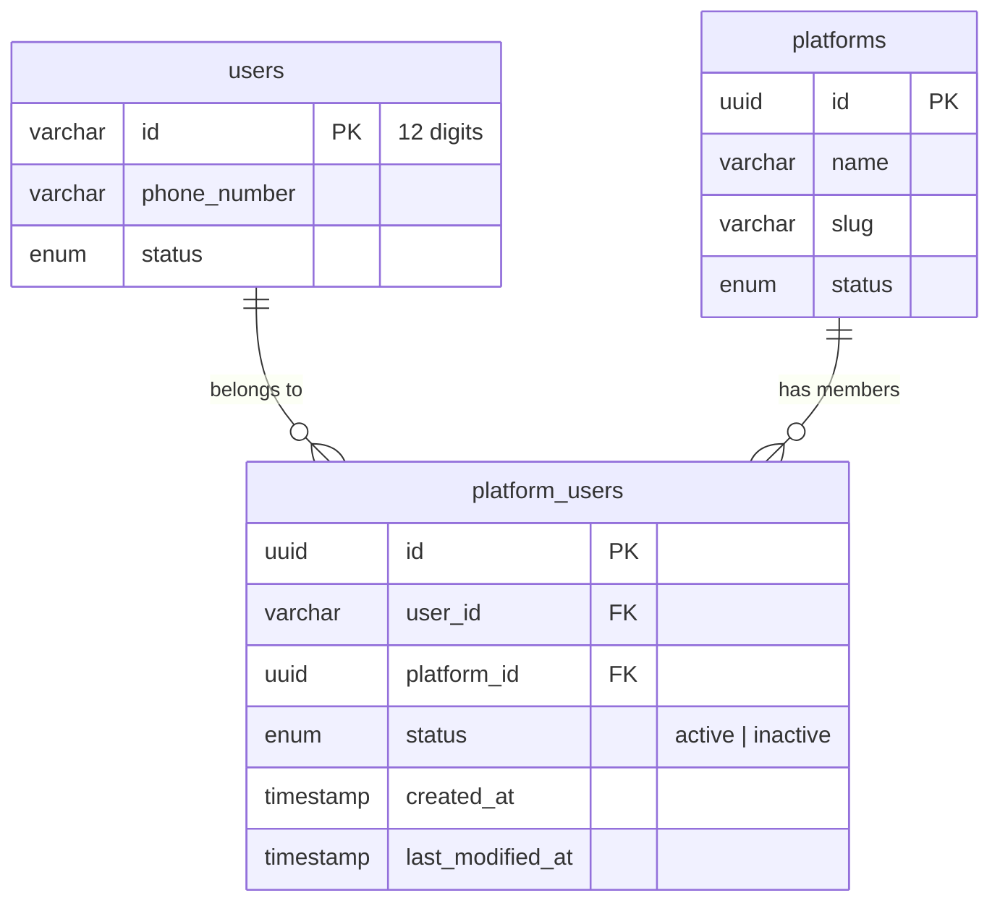

The `platform_users` table records **membership**: which users belong to which
platform (tenant).

<Info>
  **No mutation API** for memberships. Rows are written in only two ways:

  1. `POST /auth/token` — automatically, on every login. See below.
  2. `POST /platform_users/backfill` — admin-only, one-shot, run once
     per environment after deploy.

  Reads go through one endpoint of its own (admin, or a platform-scoped
  token pinned to it); `GET /platforms` and `GET /users/details/basic`
  also read the table:
  `GET /platform_users?user_id=…&platform_id=…&statuses=…` — a flat list of
  raw rows, newest-first by default.
</Info>

## The relationship is many-to-many

A user is keyed by their **phone number**, and the same phone can sign in
through more than one partner platform. So a user holds **one membership row
per platform**, not a single platform assignment.



<Warning>
  Uniqueness is enforced on the **pair** `(user_id, platform_id)`, never on
  `user_id` alone. A user with several memberships is normal and expected.
</Warning>

This is also why the tenant is **not** a column on `users`. A scalar
`users.platform_id` would be ambiguous the moment a phone appeared on a second
platform, and the second signup would silently overwrite the first.

## How memberships are created

`POST /auth/token` is the only path a user enters the system, and the only
place the platform is authoritative — it comes from the calling platform's
service-account JWT claim, never from a request body, so it cannot be spoofed.

<Steps>
  <Step title="A platform mints an app token">
    The partner backend calls `POST /auth/token` with its service-account
    bearer token and the user's phone number.
  </Step>
  <Step title="The user is found or created">
    Existing phone → the existing user. New phone → a fresh `ONBOARDING`
    user.
  </Step>
  <Step title="The membership is recorded">
    The `(user, platform)` pair is upserted. Idempotent — every subsequent
    login through the same platform is a no-op, and a login through a
    **different** platform simply adds a second membership.
  </Step>
</Steps>

## Reading memberships

`GET /platform_users` returns a flat, filtered page of `platform_users`
rows. Every filter is optional and composes with AND.

```bash All rows (paginated)
curl "$BASE_URL/platform_users?limit=20&offset=0" \
  -H "Authorization: Bearer $ADMIN_TOKEN"
```

```bash Filter by platform + status
curl "$BASE_URL/platform_users?platform_id=0194e0f3-4b2a-7123-8f4a-9d5e2c8b1a3d&statuses=ACTIVE" \
  -H "Authorization: Bearer $ADMIN_TOKEN"
```

```bash Look up one pair
curl "$BASE_URL/platform_users?user_id=012345678901&platform_id=0194e0f3-..." \
  -H "Authorization: Bearer $ADMIN_TOKEN"
```

| Behaviour | Detail |
|---|---|
| Auth | Admin (incl. read-only admin), or a platform-scoped token pinned to it — see below. |
| Response | Raw row shape (`user_id`, `platform_id`, `status`, `created_at`, `last_modified_at`) — no join to `users`, no PII. |
| `sort_on` / `sort_by` | Sort column `created_at` (default) or `last_modified_at`; direction `asc` or `desc` (default). Ties break on `(user_id, platform_id)`, so pages are stable. |
| `start_time` / `end_time` | Inclusive window on `created_at` (ISO 8601). `end_time` is optional. |
| `user_id` | Exact match. Must be exactly 12 digits — malformed input returns 400. |
| `platform_id` | Exact UUID match. |
| `statuses` | Comma-separated `ACTIVE` / `INACTIVE`. Omit to match both. |
| `limit` / `offset` | Standard pagination. `limit` defaults to 20, capped at 100. |

### Calling with a non-admin token

The token wins over the query: a pinned filter takes the token's value, whatever the query says.

| Token | Pinned |
|---|---|
| Contributor | `platform_id`; also `user_id` when bound to a beneficiary (unbound: `user_id` stays a free filter within the platform) |
| App user | `platform_id` and `user_id` |
| Dashboard user / platform service | `platform_id` |
| Any other non-admin token | refused — **403** |

`statuses`, `limit` and `offset` behave exactly as for admins.

```bash Contributor — the beneficiary's membership on the token's platform
curl "$BASE_URL/platform_users" \
  -H "Authorization: Bearer $CONTRIBUTOR_TOKEN"
```

## Backfilling historical memberships

`POST /platform_users/backfill` is a one-shot admin endpoint. The
migration ships **schema only**; this endpoint fills in the `(user, platform)`
pairs that predate the table.

Run it with `dry_run` first to see exactly what it would do, then for real:

```bash Dry run
curl -X POST "$BASE_URL/platform_users/backfill" \
  -H "Authorization: Bearer $ADMIN_TOKEN" \
  -H "Content-Type: application/json" \
  -d '{"dry_run": true}'
```

```json Response
{
  "total_processed": 3,
  "succeeded": 0,
  "skipped": 3,
  "failed": 0,
  "results": [
    {
      "user_id": "012345678901",
      "platform_id": "0194e0f3-4b2a-7123-8f4a-9d5e2c8b1a3d",
      "outcome": "DRY_RUN",
      "detail": "would link to platform 0194e0f3-4b2a-7123-8f4a-9d5e2c8b1a3d (from the ledger)"
    },
    {
      "user_id": "012345678902",
      "platform_id": "0194e0f3-4b2a-7123-8f4a-9d5e2c8b1a3d",
      "outcome": "DRY_RUN",
      "detail": "would link to platform 0194e0f3-4b2a-7123-8f4a-9d5e2c8b1a3d (fallback: oldest active)"
    },
    {
      "user_id": "012345678903",
      "platform_id": "0194e0f3-4b2a-7123-8f4a-9d5e2c8b1a3d",
      "outcome": "DRY_RUN",
      "detail": "would link to platform 0194e0f3-4b2a-7123-8f4a-9d5e2c8b1a3d (fallback: oldest active)"
    }
  ]
}
```

Every candidate is read once, then each is linked on its own, so a failing
candidate is reported and the run carries on. `results` lists only the users
that were **not** linked:

| `outcome` | Meaning |
|---|---|
| `DRY_RUN` | Resolved cleanly; nothing written because `dry_run` was set. |
| `SKIPPED` | No active platform to fall back to (`platform_id` absent). |
| `FAILED` | The write failed; `detail` says why. Safe to re-run. |

Two steps:

| Step | What it does |
|---|---|
| **1. From the ledger** | Every `(user_id, platform_id)` pair `benefit_entities` proves that has no membership yet. `created_at` is copied from the ledger's oldest matching row. |
| **2. Fallback** | Users with no membership and no ledger rows get the **oldest active** platform. Exact in a single-tenant environment, a placeholder otherwise — **operators must correct these on multi-tenant targets**; the dry run lists exactly which users they are. |

**Re-runnable.** A user–platform pair that already has a membership row (even a revoked one) is never a candidate, so once everything
is linked a rerun reports `succeeded: 0`, and a run interleaved with logins
covers only the pairs login has not linked yet. A user whose ledger insert
failed is not pushed onto the fallback platform; the next run retries it.

`created_at` is copied from the source row, so it records when the membership
began rather than when the backfill ran. A revoked pair is left revoked.

## Revoking a membership

There is no API for this. The `status` column exists so an operator can
revoke a membership directly in the database. Each (user, platform) pair has
exactly one row, so a revoked membership is flipped back to active in place on
the user's next login through that platform.
